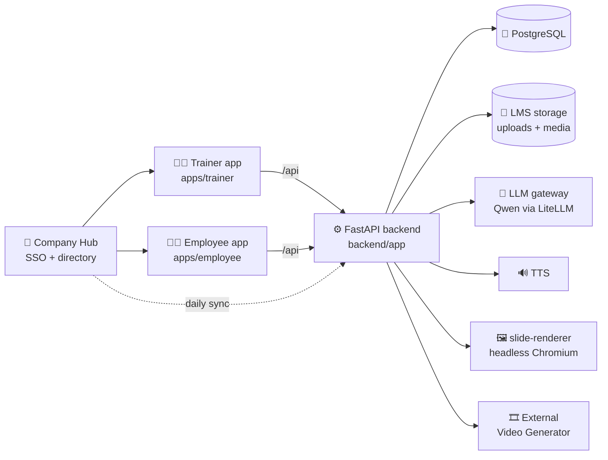
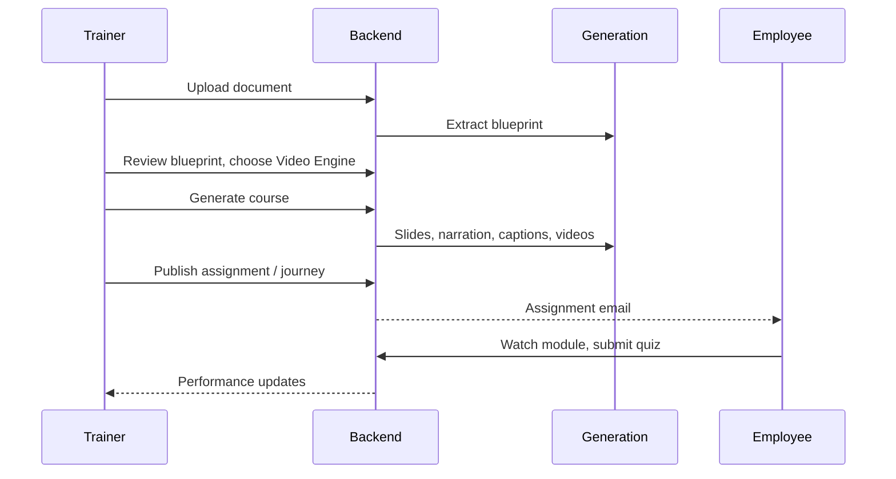
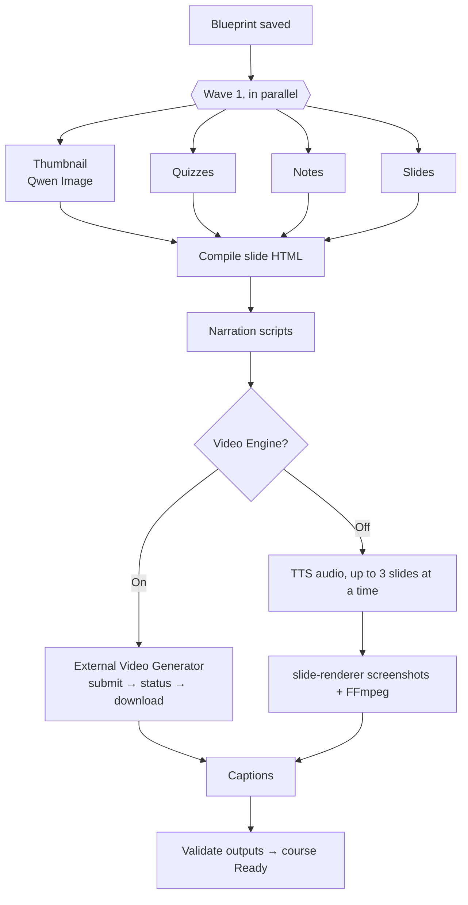
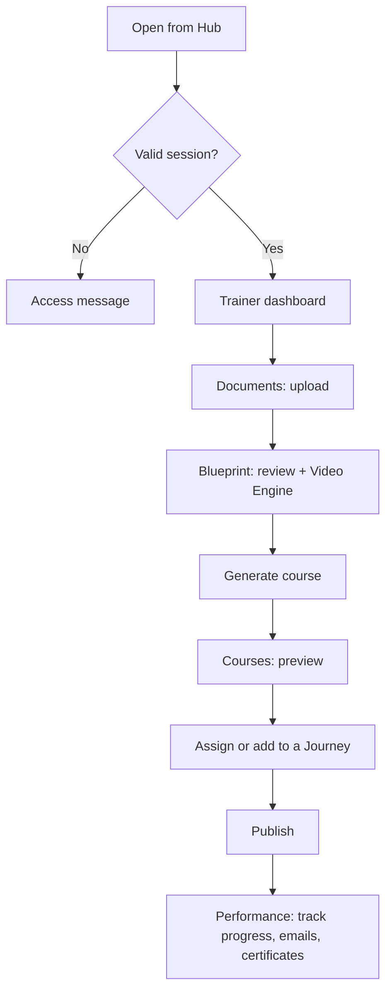
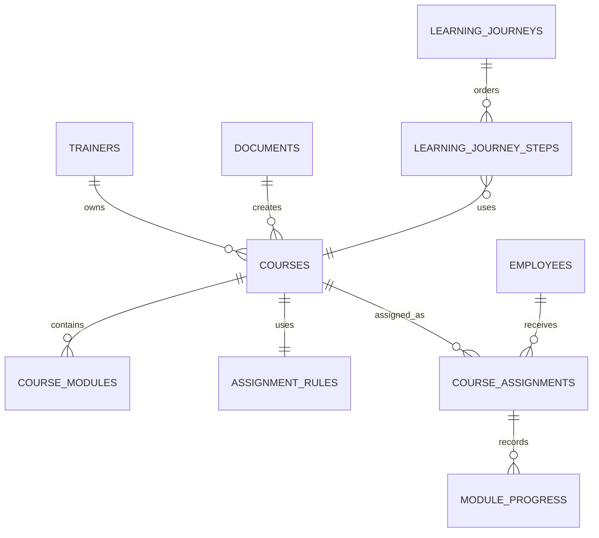

<div align="center">

# 🎓 PhillipAcademy LMS

**Turn training documents into video courses, assign them to the right people, and track who completed them.**


[What it does](#-what-it-does) ·
[How it works](#-how-it-works) ·
[Project layout](#-project-layout) ·
[Quick start](#-quick-start) ·
[Operations](#-operations) ·
[Recent changes](#-recent-changes)

</div>

> Learners and trainers see the product as **PhillipAcademy**. Inside the code it is still called **LMS**.
> New to the codebase? Read **[docs/ARCHITECTURE.md](docs/ARCHITECTURE.md)** first: it maps every feature to its files.

---

## ✨ What it does

| | Feature | In short |
|---|---|---|
| 📄 | **Documents** | Trainers upload PDF, PPTX or DOCX files, or draft a new document with the AI **Document Builder**. |
| 🧭 | **Blueprint** | The backend turns a document into an editable course outline: modules, objectives, quiz counts. Numbered "Module" headings split the course exactly as written. |
| 🎬 | **Course generation** | Thumbnail, notes, quizzes, slides, narration, captions and module videos, all checkpointed so a failed step can be continued. |
| 🎛️ | **Video Engine toggle** | Per course, on the Blueprint tab. The LMS recommends the **external Video Generator** for text-only documents and the built-in engine (slides + TTS + FFmpeg) when the document has meaningful images. The trainer decides. |
| 💬 | **Captions** | Every module video gets captions, timed from the measured narration. |
| 🎯 | **Assign** | Include/exclude rules by employee, department, mailing list or saved group, with deadlines and searchable pickers. |
| 🗺️ | **Learning Journeys** | Ordered paths of courses, each with its own observers, deadlines, emails and a **stamped PDF certificate** on completion. |
| 👀 | **Observers** | Named people or departments who may follow a course's or a journey's results. |
| 📊 | **Performance** | Overview, Courses, Employees, Journeys and **Email status** views, with CSV export, all scoped to what the viewer may see. |
| ✉️ | **Emails** | Assignment, reminder, due-soon, overdue (capped, with a final escalation) and certificate emails, plus role-scoped digests for HODs and trainers. |
| 🔐 | **Hub SSO** | Users open the apps from the company Hub. The employee directory syncs from Hub every day. |

---

## 🧩 How it works



### The course lifecycle in plain words

1. A **trainer** uploads a training document (or builds one in the Document Builder).
2. The backend reads it and proposes a **blueprint**. The trainer reviews it, edits it if needed, and picks the Video Engine.
3. **Generate** builds the course: thumbnail, notes, quizzes, slides, narration, captions and videos.
4. The trainer **assigns** the course, or adds it to a **Learning Journey**, and publishes.
5. The backend matches the rules against the synced Hub directory and creates assignments. Emails go out.
6. **Employees** see only what was assigned to them. They watch each module, pass its quiz, and unlock the next one.
7. Trainers, HODs and observers follow progress in **Performance**. Journey completers receive a certificate.



<details>
<summary><b>🎬 Course generation pipeline (detail)</b></summary>

Generation is checkpointed and resumable. If a stage fails, the trainer presses **Continue**, and the pipeline restarts from the failed checkpoint instead of from the beginning.



The built-in engine captures each HTML slide as a PNG frame, combines it with its narration WAV, and joins the slide clips into one MP4 per module. Captions are timed from the measured narration when no caption aligner is installed.

</details>

<details>
<summary><b>🧑‍🏫 Trainer app: tabs and endpoints</b></summary>

Tabs: **Documents → Blueprint → Courses → Journeys → Assign → Performance**. The Journeys tab appears when the backend reports Learning Journeys as enabled.

| Tab | Main purpose | Main endpoints |
| --- | --- | --- |
| Hub gate | Confirms the trainer opened the app through Hub (or local dev mode) | `/api/hub/session/trainer`, `/api/auth/local/trainer-login` |
| Documents | Upload documents, preview them, and use the Document Builder | `/api/upload`, `/api/files`, `/api/document-builder/...` |
| Blueprint | Turn a document into an editable outline and choose the Video Engine | `/api/courses/generate`, `/api/courses/{course_id}` |
| Courses | Review modules, slides, quizzes and videos; enable, disable or delete | `/api/courses`, `/assets/...` |
| Generation | Generate everything, or one stage or module at a time | `/api/courses/{course_id}/generation-jobs`, `.../generate-*` |
| Journeys | Build ordered course paths, with observers, preview and publish | `/api/learning-journeys/...` |
| Assign | Who receives a course, saved groups and Observers | `/api/assignment/options`, `/api/courses/{course_id}/publish-assignment`, `/api/courses/{course_id}/observers` |
| Performance | Overview, Courses, Employees, Journeys, Email status, CSV export | `/api/trainer/performance/...` |



</details>

<details>
<summary><b>🧑‍💻 Employee app: screens and learning rules</b></summary>

| Screen | Main purpose | Main endpoints |
| --- | --- | --- |
| Hub gate | Confirms the employee opened the app through Hub (or local dev mode) | `/api/hub/session/employee` |
| Dashboard / My Courses | Assigned work, due dates and status filters | `/api/me/courses` |
| Notifications | Live updates when something new is assigned | `/api/me/courses/ws` |
| Course playback | Module videos with captions, notes, quizzes, unlock rules | `/api/me/courses/{course_id}/modules/{module_number}` |
| Learning Journeys | Journey progress and the downloadable certificate | `/api/me/learning-journeys`, `.../{journey_id}/certificate` |

**Learning rules**

1. Employees only receive published courses whose active rule matches them.
2. The first module is open straight away. A module's quiz unlocks after its video is watched.
3. A module is complete when its video is watched and its quiz (if any) is passed. Then the next module unlocks.
4. A course is complete when every published module is complete.
5. Journey steps open in order. Finishing every step issues the journey certificate.
6. Progress is saved in PostgreSQL and pushed back over WebSocket, so the dashboard stays up to date.

</details>

<details>
<summary><b>🐘 Data model (main tables)</b></summary>

| Table | What it holds |
| --- | --- |
| `trainers`, `employees`, `employee_groups` | People and mailing-list membership from Hub |
| `directory_sync_state` | Cursor and status of the Hub directory sync |
| `documents` | Uploaded source documents |
| `courses`, `course_modules` | Course metadata and per-module content (notes, slides, quiz, video) |
| `course_generation_status` | Checkpoints, stage status, failures, worker lock |
| `assignment_rules`, `saved_assignment_groups`, `course_assignments` | Who gets which course, and by when |
| `module_progress`, `learning_events` | Watched/quiz state, attempts, scores, activity |
| `learning_journeys`, `learning_journey_*` | Journeys, ordered steps, rules, per-employee state, certificates, observers |
| `course_observer_*`, `lms_*` access tables | Observers, authoring roles, report access |
| `email_notifications`, `email_*` | Email outbox, delivery attempts, skips, worker status |
| `document_builder_*` | Document Builder drafts, revisions, operations |

The schema is created and upgraded automatically at startup (`app/db/schema.py`). Every migration is additive and safe to run again.



</details>

---

## 🗂️ Project layout

```text
backend/                     FastAPI API + generation pipeline (Python 3.12)
  app/
    main.py                  startup: middleware, routers, schedulers, DB init
    api/router.py            mounts every module's router
    core/                    settings, logging, errors, storage, provider clients, base schema
    security/                Hub launch tokens, public-mount checks
    db/                      connection pool, schema init, migrations/
    modules/                 ⭐ one folder per feature
      auth/  access/  directory/  courses/  uploads/  documents/
      generation/  assignments/  observers/  journeys/  learning/
      reporting/  emails/
    prompts/  templates/  static/   LLM prompts, slide templates, brand assets
  scripts/                   admin scripts + run_pipeline.py (generation worker)
  slide_renderer/            separate service that screenshots slides
  tests/                     pytest suite
apps/
  trainer/src/features/      documents, courses, training, journeys, assignments, performance
  employee/src/features/     dashboard, learning, journeys
packages/shared/             API client, models, auth, UI kit, video player, Performance screens
deploy/                      web Dockerfile used by both React apps
docs/                        architecture guide, operations notes, plans
```

Each backend module keeps the same kinds of files: `api.py` (routes), `service.py` (business rules), `repository.py` (SQL) and `schemas.py` (request/response models). There are a few extra files where a feature needs them. See **[docs/ARCHITECTURE.md](docs/ARCHITECTURE.md)** for the full map and the import rules.

---

## 🚀 Quick start

<table>
<tr><th>⚙️ Backend</th><th>🖥️ Frontends</th></tr>
<tr valign="top"><td>

```powershell
cd backend
python -m venv .venv
.\.venv\Scripts\Activate.ps1
pip install -r requirements-dev.txt
python -m uvicorn app.main:app --reload
```

Video generation with the built-in engine needs the slide renderer:

```bash
docker build -t lms-slide-renderer backend/slide_renderer
docker run --rm -p 127.0.0.1:8090:8080 lms-slide-renderer
```

Then set `SLIDE_RENDERER_URL=http://127.0.0.1:8090` in `backend/.env`.

</td><td>

Node 24 + pnpm 11 (`corepack enable`):

```bash
pnpm install
pnpm dev:trainer    # http://localhost:5173
pnpm dev:employee   # http://localhost:5174
```

The dev servers proxy `/api` and `/assets` to `http://127.0.0.1:3060`. To use another backend, set `LMS_DEV_BACKEND`.

The trainer app is served at `/lms/trainer` and the employee app at `/lms`. `VITE_API_BASE_URL` (Docker build arg `API_BASE_URL`) is needed only when the API is on another origin.

</td></tr>
</table>

**🐳 Whole stack with Docker:** `cp .env.example .env`, fill in the secrets, then `docker compose up -d --build`. See [Docker deployment](#-operations) below.

### ✅ Checks before you push

```bash
cd backend && python -m ruff check app scripts tests && python -m pytest
```

```bash
pnpm typecheck && pnpm lint && pnpm test && pnpm build
```

The PostgreSQL integration tests are opt-in. They need a throwaway database named `lms_performance_demo`, with `LMS_ACCESS_POSTGRES_TESTS=true`. The Document Builder suite needs a database named `document_builder_test`, with `DOCUMENT_BUILDER_PG_TEST=1`. Never point them at a real LMS database.

---

## 🛠️ Operations

<details>
<summary><b>🐳 Docker deployment</b></summary>

The root Compose stack runs:

```text
backend            FastAPI API and generation pipeline
slide-renderer     headless Chromium that screenshots slides for module videos
frontend           trainer React app (apps/trainer)
employee_frontend  employee React app (apps/employee)
postgres           bundled PostgreSQL, only with COMPOSE_PROFILES=bundled-db
```

```text
COMPOSE_PROFILES=bundled-db   run the bundled Postgres container (VM/test)
COMPOSE_PROFILES=             no Postgres container; use the company DATABASE_URL
```

Set up the host folders and env file once:

```bash
sudo mkdir -p /opt/lms/postgres /opt/lms/storage /opt/lms/backups
cp .env.example .env
```

The most important `.env` values are `COMPOSE_PROFILES`, `DATABASE_URL`, `POSTGRES_PASSWORD`, `CORS_ALLOWED_ORIGINS`, `LLM_BASE_URL`, `LLM_API_KEY`, `TTS_ENDPOINT`, `COURSE_THUMBNAIL_ENDPOINT`, `HUB_LAUNCH_SECRET`, `DIRECTORY_EXPORTS_API_KEY` and `DIRECTORY_SYNC_ADMIN_KEY`.

```env
# bundled Postgres (VM/test)
COMPOSE_PROFILES=bundled-db
DATABASE_URL=postgresql://lms:<password>@postgres:5432/lms
POSTGRES_DB=lms
POSTGRES_USER=lms
POSTGRES_PASSWORD=<password>

# company Postgres (on-prem)
COMPOSE_PROFILES=
DATABASE_URL=postgresql://lms_user:<password>@company-postgres-host:5432/lms_db
```

Start or update the stack:

```bash
docker compose up -d --build
```

| Port | Goes to |
| --- | --- |
| `3060` | backend (container `8000`), health check at `/health` |
| `6969` | trainer app (container `8080`) |
| `6970` | employee app (container `8080`) |
| `127.0.0.1:5432` | bundled Postgres, only with `bundled-db` |

The bundled Postgres is bound to `127.0.0.1` only. Inside Docker, the backend reaches it as `postgres:5432`.

Data lives in host folders that survive rebuilds: `/opt/lms/postgres` (bundled DB), `/opt/lms/storage` (uploads and generated media) and `/opt/lms/backups`. **Do not delete them** unless you mean to reset data.

```bash
docker compose ps
docker compose logs -f backend
docker compose stop          # stops without deleting data
```

Back up (bundled DB):

```bash
stamp=$(date +%Y%m%d_%H%M%S)
docker compose exec -T postgres pg_dump -U "$POSTGRES_USER" "$POSTGRES_DB" > "/opt/lms/backups/lms_${stamp}.sql"
tar -czf "/opt/lms/backups/storage_${stamp}.tar.gz" -C /opt/lms storage
```

For company PostgreSQL, use the company backup process, or run `pg_dump "$DATABASE_URL"` from an approved admin host.

**Deploying:** build images from a tested `main` commit, tag them `main-<sha>`, and deploy the backend and trainer images from the same commit. A backend restart interrupts any running course generation, so check that none is running first.

</details>

<details>
<summary><b>🔧 Environment variables</b></summary>

For Docker, copy the root `.env.example` to `.env`. It is the only committed env template. Direct terminal runs may use a private `backend/.env`.

```text
APP_ENV  LOG_LEVEL  CORS_ALLOWED_ORIGINS  DATABASE_URL
LLM_BASE_URL  LLM_API_KEY  LLM_MODEL_NAME
TTS_ENDPOINT  TTS_VOICE  COURSE_THUMBNAIL_ENDPOINT  COURSE_THUMBNAIL_API_KEY
GENERATION_MAX_CONCURRENCY  LMS_STORAGE_DIR
HUB_LAUNCH_SECRET  HUB_TRAINER_APP_KEY  HUB_EMPLOYEE_APP_KEY  HUB_LAUNCH_DEV_MODE
DIRECTORY_EXPORTS_BASE_URL  DIRECTORY_EXPORTS_API_KEY  DIRECTORY_SYNC_ADMIN_KEY
DIRECTORY_SYNC_ENABLED  DIRECTORY_SYNC_INTERVAL_HOURS  DIRECTORY_SYNC_TIME  DIRECTORY_SYNC_TIMEZONE
LANGFUSE_ENABLED  LANGFUSE_BASE_URL  LANGFUSE_HOST  LANGFUSE_PUBLIC_KEY  LANGFUSE_SECRET_KEY
LANGFUSE_ENVIRONMENT  LANGFUSE_RELEASE  LANGFUSE_CAPTURE_CONTENT
```

Generated uploads, audio, images, slides and videos live under `/app/storage` in the backend container, which is `/opt/lms/storage` on the VM. Structured data lives in PostgreSQL. SQLite is no longer supported.

Only these media folders are served as static assets: `/assets/audio`, `/assets/brand`, `/assets/images`, `/assets/layouts`, `/assets/slides` and `/assets/videos`. Uploaded documents, prompts, templates and private storage are never exposed.

More detail: [Qwen configuration](docs/qwen-lms-configuration.md) · [Video Generator operations](docs/video-generator-operations.md) · [Caption operations](docs/video-captions-operations.md) · [Shared path routing](docs/shared-path-routing.md)

</details>

<details>
<summary><b>✉️ Course email notifications</b></summary>

The backend generates and sends all course email. Employee messages are individual. HOD and trainer messages for due-soon, completed and overdue events are combined into authenticated, role-scoped digests. Assignment messages stay individual for the employee and the HOD. The five-day reminder goes to the employee only. Overdue emails stop after five, with a final escalation notice. Journeys send their own assigned and certificate emails.

Set `LMS_EMPLOYEE_PUBLIC_URL` and `LMS_TRAINER_PUBLIC_URL` to the externally reachable URLs, so links open the right app. `LMS_PUBLIC_URL` remains as a fallback. Digest times follow `EMAIL_NOTIFICATION_TIMEZONE` and `EMAIL_DIGEST_SEND_TIME`.

The outbox re-checks every assignment just before delivery. Items that are completed, revoked, unpublished or reassigned are dropped, and an empty digest is cancelled. The **Email status** tab in Performance shows what was sent, failed or skipped, and can resend failed items.

**Safe rollout:** start with `EMAIL_DELIVERY_MODE=log`, check the outbox and the logs, and switch to `smtp` only after SMTP connectivity and recipient data are validated.

SMTP uses verified STARTTLS or implicit TLS by default. An IT-approved plaintext relay on port 25 needs all of `SMTP_ALLOW_INSECURE_RELAY=true`, `SMTP_PORT=25`, `SMTP_USE_STARTTLS=false` and `SMTP_USE_SSL=false`, with an empty `SMTP_USERNAME`/`SMTP_PASSWORD`. A failed TLS handshake never falls back to plaintext.

Accelerated UAT testing is guarded by `EMAIL_TEST_MODE`. Test mode refuses to start without both `EMAIL_RECIPIENT_ALLOWLIST` and `EMAIL_SUBJECT_PREFIX`:

```env
EMAIL_TEST_MODE=true
EMAIL_TEST_ASSIGNMENT_REMINDER_MINUTES=5
EMAIL_TEST_DUE_SOON_WINDOW_MINUTES=7
EMAIL_TEST_OVERDUE_REPEAT_MINUTES=5
EMAIL_TEST_DIGEST_DELAY_MINUTES=1
EMAIL_SUBJECT_PREFIX=[LMS UAT TEST]
EMAIL_RECIPIENT_ALLOWLIST=first.tester@example.com,second.tester@example.com
```

Leave `EMAIL_TEST_MODE=false` outside a controlled UAT exercise. See also [SMTP deployment notes](docs/smtp-email-drafts-deployment.md).

</details>

<details>
<summary><b>🏢 Hub directory sync</b></summary>

Employees come from the Hub directory export API. Department is stored on `employees.department`. Mailing-list filters use `employee_groups.group_cn`, and `group_dn` keeps the full AD distinguished name.

First bootstrap, before users open the app:

```bash
docker compose exec backend python -m scripts.sync_directory full
docker compose exec backend python -m scripts.sync_directory incremental --after-id 0
```

After that, keep `DIRECTORY_SYNC_ENABLED=true`. Incremental sync runs once a day at `DIRECTORY_SYNC_TIME` in `DIRECTORY_SYNC_TIMEZONE` (defaults `09:10`, `Asia/Kolkata`).

Changes are merged by stable Hub identity (`hub_user_id`, `directory_uuid`), not by email. Partial events only update the fields they include. A disabled or missing employee is soft-disabled: courses, assignments, progress and files stay intact.

Manual endpoints are protected by `X-Directory-Sync-Key`:

```bash
curl -sS -H "X-Directory-Sync-Key: $DIRECTORY_SYNC_ADMIN_KEY" http://127.0.0.1:3060/api/directory/sync/status
curl -sS -X POST -H "X-Directory-Sync-Key: $DIRECTORY_SYNC_ADMIN_KEY" http://127.0.0.1:3060/api/directory/sync/incremental
```

Rotate the directory export API key before production if it has ever been shared outside secret storage.

</details>

<details>
<summary><b>📈 Performance reporting: rules, rollout and local demo</b></summary>

The reporting unit is an **active employee-course assignment**:

- **Completion rate:** completed ÷ active assignments.
- **Due soon:** incomplete, and due within `EMAIL_DUE_SOON_DAYS`.
- **Overdue:** incomplete, and past its deadline.
- **On-time compliance:** completed by the deadline ÷ assignments whose deadline has passed.
- **Average score:** uses the latest scored result for each attempted module.

The Employees view rolls up all scoped assignments in PostgreSQL before paging. Both CSV exports stream in batches of 100 and protect cells against formula injection. Every endpoint enforces the caller's trainer, HOD or observer scope.

Quiz attempts and video events go into `learning_events` from the reporting upgrade onward. Earlier individual attempts can't be reconstructed.

**On the VM:** deploy the backend and trainer app from the same commit. Never run `scripts.seed_performance_demo` there. Startup adds the reporting tables and columns. If the report is empty, check that the course is published, its rule is active, and its employees have non-revoked assignments.

**Local demo:** use a separate database named `lms_performance_demo` with `HUB_LAUNCH_DEV_MODE=true`:

```powershell
.\.venv\Scripts\python.exe -m scripts.seed_performance_demo
.\.venv\Scripts\python.exe -m uvicorn app.main:app --host 127.0.0.1 --port 3061
```

Then run `LMS_DEV_BACKEND=http://127.0.0.1:3061 pnpm dev:trainer` and sign in as *Performance Demo Trainer*. The seed refuses to run against any other database.

</details>

<details>
<summary><b>🔭 Langfuse LLM tracing</b></summary>

Tracing is off by default and fails open: if Langfuse is missing or broken, course generation still runs. `LANGFUSE_BASE_URL` is the preferred setting, and `LANGFUSE_HOST` still works.

```env
LANGFUSE_ENABLED=true
LANGFUSE_BASE_URL=http://<langfuse-host>:3100
LANGFUSE_PUBLIC_KEY=pk-lf-...
LANGFUSE_SECRET_KEY=sk-lf-...
LANGFUSE_ENVIRONMENT=uat
LANGFUSE_RELEASE=<deployed-git-commit>
LANGFUSE_CAPTURE_CONTENT=false
LANGFUSE_CAPTURE_MAX_CHARS=12000
LANGFUSE_TIMEOUT_SECONDS=5
```

Keep `LANGFUSE_CAPTURE_CONTENT=false` unless storing prompts and outputs has been approved. If the LiteLLM gateway already sends calls to Langfuse, don't enable app-side tracing as well, or every request will appear twice.

</details>

<details>
<summary><b>♻️ Clean production reset</b></summary>

Normal startup only creates missing tables and never deletes rows. To wipe a VM/test deployment (`bundled-db`), **back up first**, then:

```bash
docker compose stop backend frontend employee_frontend
docker compose run --rm backend python -m scripts.recreate_lms_database
docker compose run --rm backend python -m scripts.sync_directory full
docker compose run --rm backend python -m scripts.sync_directory incremental --after-id 0
docker compose up -d --build
```

This deletes LMS rows and uploaded/generated files, then reloads employees from Hub. Templates and brand assets are kept. For company PostgreSQL, coordinate the reset with database operations first.

</details>

<details>
<summary><b>🧱 Remaining production hardening</b></summary>

1. Versioned database migrations (today: additive startup migrations in `app/db/`).
2. Run the API and the generation worker as separate services.
3. A durable generation queue for multi-process deployments.
4. Secrets in deployment secret management.
5. HTTPS through a reverse proxy, and CORS locked to the real frontend URLs.
6. API, database, provider and worker health checks.
7. Upload size/type limits and API rate limits.
8. Structured logs, alerts, backups and queue monitoring.

</details>

---

## 🆕 Recent changes

| Area | What changed | PRs |
| --- | --- | --- |
| 🧱 Code structure | Backend grouped by feature under `app/modules/`, the employee app under `features/`, plus an import-rule check | this PR |
| 🐳 Images | Chromium moved out of the backend image (4.2 GB → 1.6 GB); Hub can launch the apps from the frontend URL | #72, #73 |
| 📊 Performance | **Email status** tab with resend; search in the observer, journey and picker lists; Outlook button fix | #67, #68, #71 |
| 🗺️ Learning Journeys | Journeys with observers, step thumbnails, deadline changes, results in Performance, **stamped PDF certificate** and certificate emails | #39, #45, #51, #57–#59, #70 |
| 🎛️ Video | **Video Engine toggle** per course; external Video Generator integration; Continue after an engine switch; empty slide plans retried | #41, #61–#63, #65 |
| 💬 Captions & narration | Captions timed from narration; caption file permissions; volume kept across modules; AML/SEBI/FIU-IND pronunciation; narration of images from Word alt text | #42–#44, #66, #69 |
| 🧭 Blueprint | Module split and titles taken from the document's own "Module" labels | #40, #64 |
| 🤖 Models | Qwen used throughout, including Qwen Image thumbnails | #38, #54, #56 |
| ✉️ Emails | Overdue emails capped at five, with a final escalation | #49 |
| 🏷️ Branding | Product shown as **PhillipAcademy** | #60 |
| 🧑‍💻 Learner UX | Video controls auto-hide; employee Performance page scrolls; delete with Enter | #47, #48, #52 |
| ⚙️ Defaults | New Documents page and Learning Journeys on by default | #55 |
| 🔒 Security | Pillow 13 and certifi upgrades in the backend image | #53 |

---

<div align="center">

📚 **More docs:** [Architecture guide](docs/ARCHITECTURE.md) · [Video Generator](docs/video-generator-operations.md) · [Captions](docs/video-captions-operations.md) · [Admin trainer access](docs/admin-trainer-access-operations.md) · [Qwen setup](docs/qwen-lms-configuration.md)

</div>
