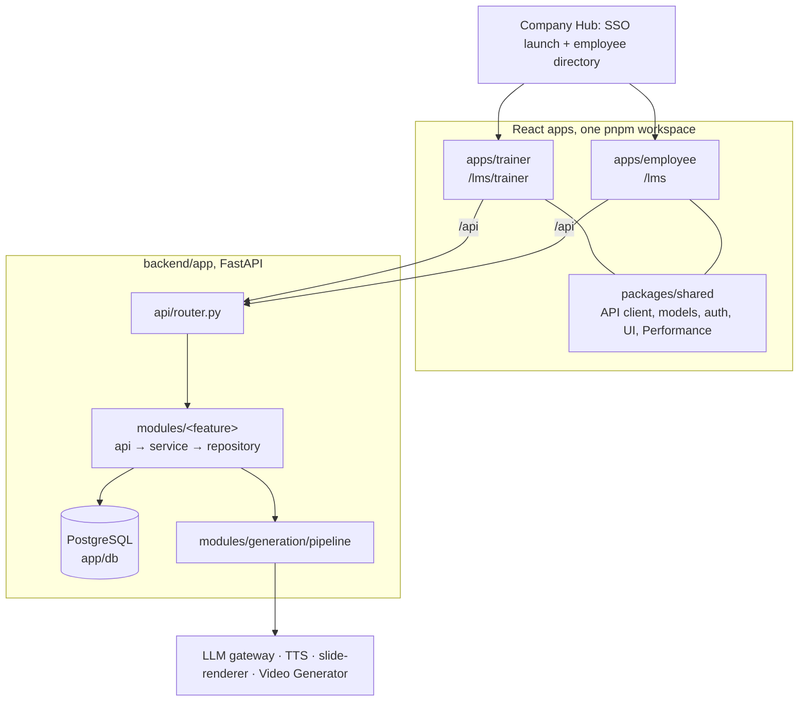

# LMS Architecture Guide

Start here if you are new to this codebase. This page tells you how the system is
put together and where to find the code for each feature. For setup, Docker,
environment variables and operations, see the [README](../README.md).

Learners and trainers see the product as **PhillipAcademy**. Inside the code it
is still called **LMS**.

## 1. The system in one picture



`docker-compose.yml` runs five containers: `postgres` (optional, the
`bundled-db` profile), `backend`, `slide-renderer`, `frontend` (the trainer app)
and `employee_frontend`.

## 2. Backend layout

```text
backend/app/
  main.py            app startup: middleware, router, schedulers, DB init
  api/
    router.py        the one place every module router is mounted
    static_assets.py allowlisted public files (logo)
  core/              cross-cutting code with no business rules:
                     settings, logging, errors, storage paths, provider clients,
                     request context, Langfuse tracing, base ApiSchema (schemas.py)
  security/          Hub launch-token middleware, public-mount validation
  db/                database.py (pool), schema.py (init_db), migrations/
  modules/           one folder per product feature (see section 4)
  prompts/           Markdown prompt templates      ─┐ found through
  templates/         slide HTML/CSS templates         ├ core/settings.py,
  static/            public brand assets             ─┘ not file location
backend/scripts/     admin scripts + run_pipeline.py (the generation worker)
backend/slide_renderer/  separate service that screenshots slides
backend/tests/       pytest suite (one file per behaviour, names unchanged)
```

### Inside a module

Every module uses the same file names, so after one you know them all:

| File | What goes in it | May import |
|---|---|---|
| `api.py` (and `*_api.py`) | FastAPI routes: auth dependencies, input validation, HTTP errors | its own service and schemas, `core`, `security`, `modules.auth` |
| `service.py` (and other plain names) | Business rules: what the feature does | its own repository, other modules' **services**, `core`, `db` |
| `repository.py` (and `*_repository.py`) | SQL only: reads and writes | `db`, `core`, its own schemas |
| `schemas.py` (and `*_schemas.py`) | Pydantic request/response models | `core.schemas` |
| `README.md` | What the module does, and its routes and tables | |

## 3. How a request flows

1. `app/main.py` builds the app and mounts `api/router.py`.
2. A route in `modules/<feature>/api.py` resolves the caller through
   `modules/auth/service.py` and validates input with `schemas.py`.
3. It calls `service.py`, where the business rules live.
4. The service reads and writes through `repository.py`, using the pool in
   `app/db/database.py`.
5. Application errors become HTTP responses in `core/exceptions.py`.

Background work started in `main.py` at startup:

| What | Where |
|---|---|
| Generation queue (runs `scripts/run_pipeline.py` per course) | `modules/generation/generation_queue.py`, `jobs.py` |
| Recovery of interrupted generations | `modules/generation/pipeline/runtime.py` |
| Daily Hub directory sync | `modules/directory/scheduler.py` |
| Email outbox scheduler | `modules/emails/notifications.py` |
| Document Builder jobs (only when the feature flag is on) | `modules/documents/builder/workflow_jobs.py` |

The schema is created and upgraded on startup by `app/db/schema.py`, which runs
the additive, repeatable migrations in `app/db/migrations/`.

## 4. Where do I find X?

| Feature | Module | Frontend |
|---|---|---|
| Sign-in, Hub launch, sessions | `modules/auth/` (`hub_api.py`, `api.py`, `service.py`) + `security/hub_launch.py` | `packages/shared/src/auth`, `apps/*/src/auth` |
| Permissions: authoring roles, report access | `modules/access/` (`service.py`, `course_authorization.py`, `report_access.py`, `reporting_scope.py`) | `packages/shared/src/auth` |
| Employee/trainer directory, Hub sync | `modules/directory/` (`sync.py`, `scheduler.py`, `employees_repository.py`, `trainers_repository.py`) + `scripts/sync_directory.py` | employee pickers in `apps/trainer/src/features/assignments` |
| Uploads (PDF, PPTX, DOCX) | `modules/uploads/` | `apps/trainer/src/features/documents` |
| Documents: text extraction + AI Document Builder | `modules/documents/` (`extraction/`, `builder/`, `builder_api.py`, `drafts_api.py`, `builder_service.py`, `drafts_repository.py`, `workflow_schemas.py`) | `apps/trainer/src/features/documents` (incl. `builder/`) |
| Courses: authoring, library, enable/disable/delete | `modules/courses/` (`api.py`, `library_api.py`, `service.py`, `lifecycle.py`, `access.py`, `artifacts.py`) | `apps/trainer/src/features/courses`, `features/training` |
| Course generation pipeline | `modules/generation/` (`api.py`, `service.py`, `generation_queue.py`, `jobs.py`, `pipeline/*`, `schemas/*`) + `scripts/run_pipeline.py` | `apps/trainer/src/features/courses`, `features/training` |
| Video Engine choice, video, captions | `modules/generation/pipeline/` (`video_engine.py`, `video.py`, `video_service.py`, `captions.py`) | Blueprint tab in `features/courses` |
| Assignments | `modules/assignments/` (`service.py`, `conflicts.py`, `deadlines.py`, `saved_groups_repository.py`) | `apps/trainer/src/features/assignments` |
| Course Observers | `modules/observers/` | `features/assignments` |
| Learning Journeys + certificates | `modules/journeys/` (`service.py`, `state.py`, `reporting.py`, `certificates.py`, `observers_repository.py`) | `apps/trainer/src/features/journeys`, `apps/employee/src/features/journeys` |
| Learner playback, media, progress, live updates | `modules/learning/` (`api.py`, `media_api.py`, `service.py`, `media_access.py`, `notifications.py`, `progress_repository.py`) | `apps/employee/src/features/learning`, `features/dashboard`, `packages/shared/src/video` |
| Performance report, analytics | `modules/reporting/` (`api.py`, `analytics.py`, `performance.py`, `repository.py`) | `packages/shared/src/performance`, `apps/trainer/src/features/performance` |
| Emails + Email status tab | `modules/emails/` (`notifications.py`, `templates.py`, `status.py`, `status_api.py`) | `packages/shared/src/performance/EmailsView.tsx` |
| Settings and provider clients | `core/settings.py`, `core/providers.py`, `.env.example` | `VITE_*` build variables |
| Database schema and migrations | `db/schema.py`, `db/migrations/` | n/a |

## 5. Frontend layout

- **`apps/trainer/src`**: `App.tsx` sets up the Hub gate, session and providers.
  `shell/TrainerShell.tsx` draws the tabs. Each tab is a folder in `features/`
  (`documents`, `courses`, `training`, `journeys`, `assignments`, `performance`).
- **`apps/employee/src`**: the same start-up pattern. Screens are in
  `features/` (`dashboard`, `learning`, `journeys`). `auth/` and the `test/`
  helpers stay at the top level.
- **`packages/shared/src`**: imported as `@lms/shared/...`. It holds the API
  client (`api/`), data models (`models/`), auth and session (`auth/`), the UI
  kit (`ui/`), the video player (`video/`), and the Performance screens both
  apps use (`performance/`).

Rule of thumb: code used by both apps goes in `packages/shared`. Code used by
one app goes in that app's `features/<area>/`, with its tests next to it.

## 6. Rules to follow when you change code

1. **Put new code in its feature module.** For a new feature, create
   `modules/<feature>/` with `api.py`, `service.py`, `repository.py`,
   `schemas.py` and `README.md`, then mount its router in `api/router.py`.
2. **Keep the layers inside a module.** Routes call services, and services call
   repositories. No SQL in `api.py` or `service.py`. No FastAPI in
   `repository.py`.
3. **Between modules, call services.** Don't reach into another module's
   repository. Older code still does this in places (see section 7), so don't
   add new cases.
4. **`core/`, `security/` and `db/` stay feature-free.** They must not import
   from `modules/`. `lint-imports` checks this, with the existing exceptions
   listed explicitly.
5. **Schema changes are additive.** Add a file to `db/migrations/` and call it
   from `db/schema.py`. It must be safe to run again.
6. **Settings come from `core/settings.py`.** Don't read environment variables
   anywhere else.
7. **Before pushing, run:**

   ```bash
   cd backend && python -m ruff check app scripts tests && python -m pytest && lint-imports
   ```

   ```bash
   pnpm typecheck && pnpm lint && pnpm test && pnpm build
   ```

## 7. Known structural debt

These are real. Fixing them means changing logic, not just moving files, so
each needs its own change:

- **Modules read each other's repositories** in about 40 places. For example,
  `generation` reads `courses.repository`, and several modules read
  `directory.employees_repository`. The fix is to route those reads through the
  owning module's service.
- **`core/providers.py` imports from `modules/generation`** (`retry`, the chat
  request schema). **`db/schema.py` imports table creators from
  `modules/journeys` and `modules/documents`.** These are listed as ignored
  imports in the `lint-imports` contract.
- **Large files**: `emails/notifications.py`, `generation/pipeline/blueprint.py`,
  `journeys/service.py`, `generation/pipeline/captions.py`, and in the trainer
  app `features/documents/FocusedWorkspace.tsx` and
  `features/journeys/JourneysTab.tsx`.
- **No migration tool**: migrations are additive Python files run at startup.

## 8. History

Until November 2026 the backend was split by technical layer (`api/`,
`services/`, `repositories/`, `schemas/`). The move to `modules/` happened in
one PR, one commit per module. It only moved files and rewrote imports, and the
OpenAPI output and the full test suite were identical before and after. To
find a file's old location, run `git log --follow <new path>`.
