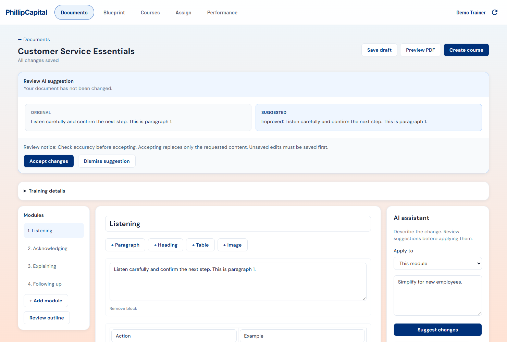
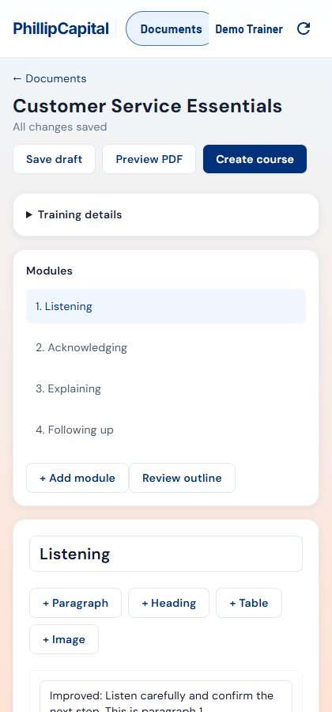

# Document workflow integration with React main

This branch incorporates `main` at `362add8` (React migration PR #30). The Flutter
applications remain removed. The earlier Flutter implementation history and its
screenshots are historical references; React is the maintained frontend.

## Included behavior

- Documents shows Use existing content, Generate with AI, Start blank, recent
  drafts, and the document library. A ready uploaded file goes directly to the
  existing Blueprint extraction workflow; Edit first and pasted notes open a
  persistent editing draft instead.
- AI setup requires title, audience and learning goals. Optional settings default
  to four modules and standard length. Outline suggestions require acceptance,
  and structure approval is explicit before generating content or creating a
  course. Course creation requires included modules with text and complete
  metadata; the server remains the final authority.
- The focused React workspace edits structured modules, text, headings, images
  and tables. IDs and source references survive round trips. Images are fetched
  with trainer authorization and handed off through the existing owned catalog.
- AI editing supports selected text, the current module, or the whole document.
  Original and Suggested content are separate from the review notice. Nothing
  applies until accepted. Revision conflicts keep proposals reviewable. Inputs
  are disabled during generation so completion cannot overwrite unsaved edits.
- Draft removal offers Undo and Close, and the notice expires after ten seconds.
- Employee playback fetches fresh progress on entry and resumes the first
  incomplete module. Failed entry refresh requires Retry. Inline quiz review
  colors only the actual selected option; answer keys and explanations are not
  returned to learners. Continue/Rewatch/Finish are explicit. The completion
  counter is neutral before submission and hidden afterward. Missing historical
  scores are not fabricated as zero.
- Captions and the isolated pilot use React. See
  [React pilot and caption player](react-pilot-caption-port.md).

The main Performance/Observer implementation is unchanged. No new model or
provider is introduced by the React port: the existing backend workflow still
validates strict model schemas, scope, ownership, source references and revisions.
HTTP deployments use secure random bytes for IDs and an HTTP-compatible SHA-256
implementation for selection fingerprints.

## Rollout

`DOCUMENT_BUILDER_WORKFLOW_ENABLED` remains false by default. React reads the
authenticated capabilities endpoint, shows a loading state while it resolves,
and retains main's legacy React Documents UI when disabled. Enable the workflow
only in the intended environment. This PR preparation does not deploy or merge.
The production rollout must build the backend and both React apps from this
branch with the repository-root `deploy/web.Dockerfile` and current environment.
Old Flutter build commands are no longer applicable.

## Verification on 2026-10-16

- Backend: 468 passed; 83 opt-in PostgreSQL tests skipped. Local Docker's Linux
  daemon was unavailable, so database integration tests were not rerun here.
- React: 398 tests passed in 54 test files, including scoped assistant requests,
  conflict-safe acceptance, draft deletion/Undo/expiry, resume, grading privacy,
  refresh failures, unsaved-edit navigation protection, captions and HTTP-compatible hashing.
- Both production builds, workspace TypeScript and ESLint passed. Prettier passed
  with `--end-of-line auto` for the Windows checkout; plain format:check flags
  inherited CRLF checkouts rather than content formatting.
- Compiled Chrome acceptance used synthetic API fixtures, with secure-context
  crypto APIs disabled: ready file to Blueprint, persistent outline generation,
  explicit proposal acceptance and approval, content drafting, table persistence,
  module-scoped assistant review/acceptance, reload, desktop and mobile layout.
  There were no uncaught browser errors. No live learner records or model calls
  were made by these tests.
- Corrected an inherited landscape-image test to match main's existing one-image
  per landscape slide behavior; rendering behavior was retained.

Screenshots from the compiled React app:

